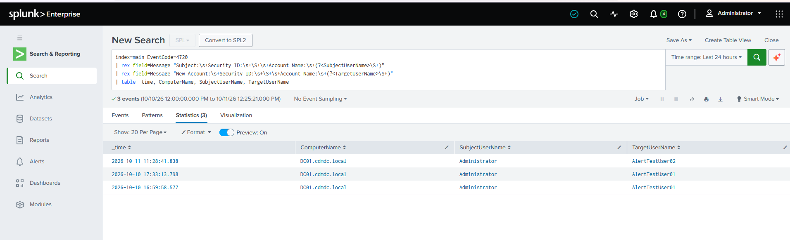
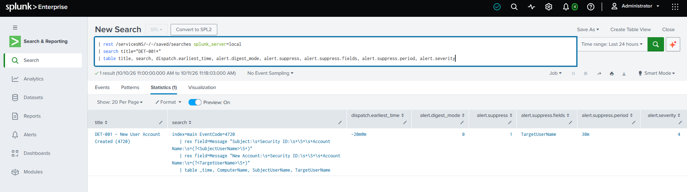
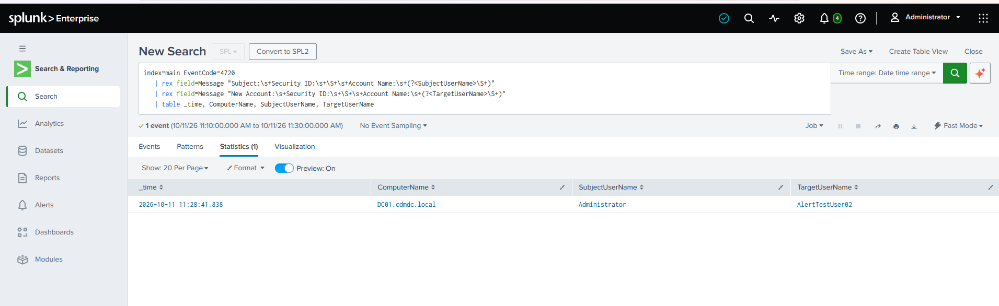
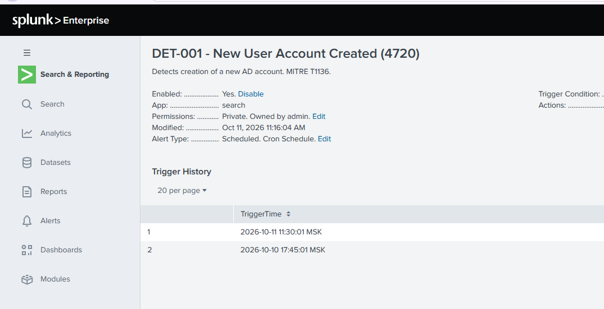
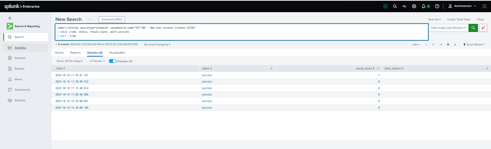

# DET-001: New User Account Created (Event ID 4720)

| Field | Detail |
|---|---|
| **Status** | Live in lab |
| **Severity** | High (stored as `alert.severity = 4`) |
| **Data source** | Windows Security log from `DC01`, forwarded by the Splunk Universal Forwarder |
| **Event ID** | 4720 - A user account was created |
| **MITRE ATT&CK** | [T1136 - Create Account](https://attack.mitre.org/techniques/T1136/) (domain account, T1136.002) |
| **Schedule** | Every 15 minutes (`*/15 * * * *`) |
| **Related** | [Investigation 01](../investigations/01-unauthorized-account-creation/), [07-splunk-siem](../07-splunk-siem/) |

---

## Purpose

Creating a new account is a common persistence technique: an attacker with administrative access adds an account so they can return after the original foothold is closed. This alert fires whenever a new account is created on the Domain Controller, so every creation gets reviewed against a legitimate change record.

---

## Detection logic

```spl
index=main EventCode=4720
| rex field=Message "Subject:\s+Security ID:\s+\S+\s+Account Name:\s+(?<SubjectUserName>\S+)"
| rex field=Message "New Account:\s+Security ID:\s+\S+\s+Account Name:\s+(?<TargetUserName>\S+)"
| table _time, ComputerName, SubjectUserName, TargetUserName
```

In this lab Splunk does not extract the account names into fields, because no Windows add-on is installed. The names exist only inside the raw `Message` text:

```
Subject:
	Security ID:		S-1-5-21-...-500
	Account Name:		Administrator
	Account Domain:		CDMDC

New Account:
	Security ID:		S-1-5-21-...-1107
	Account Name:		AlertTestUser02
	Account Domain:		CDMDC
```

Two `rex` lines pull out who created the account (`SubjectUserName`) and which account was created (`TargetUserName`).



---

## Alert configuration (as stored)

| Setting | Value |
|---|---|
| Alert type | Scheduled, cron `*/15 * * * *` |
| Time range | Last 20 minutes (`-20m@m` to `now`), overlapping each run by about 5 minutes |
| Trigger condition | Number of results is greater than 0 |
| Trigger | For each result |
| Throttle | Suppress by `TargetUserName` for 30 minutes |
| Action | Add to Triggered Alerts, severity High |
| Expires | 24 hours |
| Permissions | Private, owned by `admin` |

The saved settings can be read back directly from Splunk's REST endpoint, which confirms the time window, throttle and severity as stored:

```spl
| rest /servicesNS/-/-/saved/searches splunk_server=local
| search title="DET-001*"
| table title, search, dispatch.earliest_time, alert.digest_mode, alert.suppress, alert.suppress.fields, alert.suppress.period, alert.severity
```



---

## Validation

**Test 1 (2026-10-10).** A test account was created on `DC01` and the alert fired at 17:45:01 MSK. At that point the name fields were still blank, which led to the fixes below.

**Test 2 (2026-10-11), after the fixes.** `Administrator` created `AlertTestUser02` on `DC01` at 11:28:41.838. The 11:30:01 run (window 11:10:00 to 11:30:00) returned one result, and the alert fired about 80 seconds after the event with both names populated.





---

## Tuning journal

### 1. Blank account names

**Problem.** The first alert results showed empty `TargetUserName` and `SubjectUserName` columns, even though the names were visible in the raw event.

**Cause.** Those fields are not extracted from this data without a Windows add-on. The same gap affects the 4625 and 4768 searches in the [07-splunk-siem](../07-splunk-siem/) README, which will be corrected as those detections are rebuilt.

**Fix.** Extract the fields inline with `rex` (shown above). A production deployment would use the Splunk Add-on for Microsoft Windows. It wasn't used here because of the lab's hardware limits, and its field names would differ from the ones in this search.

### 2. An event that fell between two windows

**Problem.** An account creation at 16:59:58 never produced an alert.

**Evidence.** The scheduler log shows the runs around it all returned `result_count=0`:

```spl
index=_internal sourcetype=scheduler savedsearch_name="DET-001*"
| table _time, status, result_count, alert_actions
| sort -_time
```



**Cause.** The original window was 15 minutes on a 15-minute schedule, so the windows touched but did not overlap. The 17:00:00 run searched up to 17:00:00, about two seconds after the event, before it was indexed. The next run began its window at 17:00, after the event's timestamp, so no run ever saw it. A back-to-back window is blind to anything that is indexed late.

**Fix.** The time range was widened to 20 minutes, so each run re-checks the last 5 minutes of the previous one. The throttle (below) stops the overlap from alerting twice on one event.

### 3. The throttle option that did not appear

**Problem.** The throttle's "suppress results containing field value" box was missing from the alert dialog.

**Cause.** That box appears only when the trigger is set to **For each result**. Under **Once**, a throttle can only silence the whole alert for a period, so a second, different account created inside that period would have been missed without any warning.

**Fix.** The trigger was changed to For each result, and the throttle was set on `TargetUserName` for 30 minutes.

---

## Limitations

* **Throttle behavior not yet observed.** The throttle settings are stored and verified through Splunk's saved-search settings, but a test that recreates the same account within 30 minutes has not been run. Recreating the same account name within 30 minutes will not alert again.
* **Event 4720 shows only the moment of creation.** Its account flags do not reflect the account's final state (see [Investigation 01](../investigations/01-unauthorized-account-creation/)). Events 4722 (enabled), 4738 (changed) and 4728/4732 (group membership) are not in the forwarder whitelist, so Splunk cannot show what happens to the account afterward.
* **Computer accounts are not covered.** They log under Event ID 4741, not 4720.
* **Names containing spaces would be cut off.** The `rex` pattern captures up to the first space.
* **Detection delay is up to about 20 minutes.** The alert runs every 15 minutes and depends on the forwarder being up.
* **Legitimate onboarding also triggers it.** In production, known provisioning accounts would be excluded or the alert would be matched against change tickets.
* **The only action is Triggered Alerts.** Email, webhook or ticketing would be added in a production deployment.
* **Display quirk.** The Alerts list page reports "2 Actions", but the saved configuration contains a single action (`actions = list`). I did not investigate it further.

---

## Response

The investigation steps and the production response for this alert are worked through in [Investigation 01](../investigations/01-unauthorized-account-creation/).
