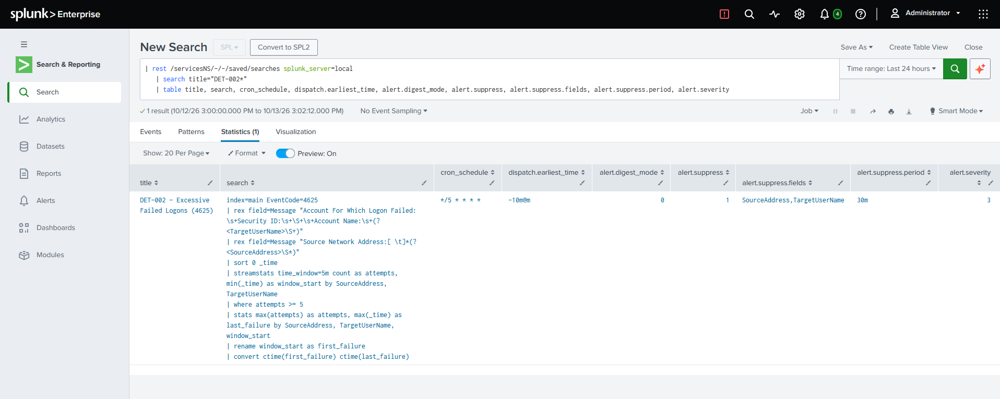
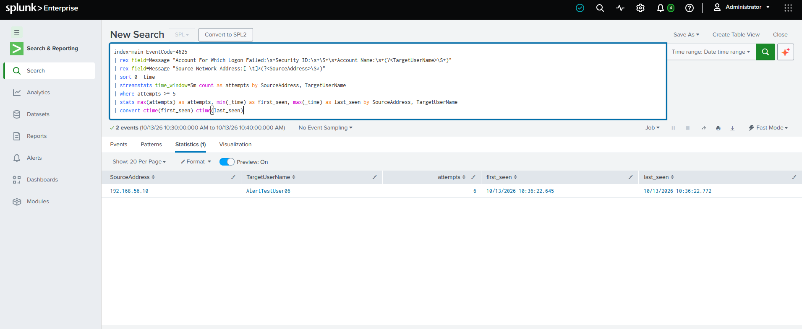
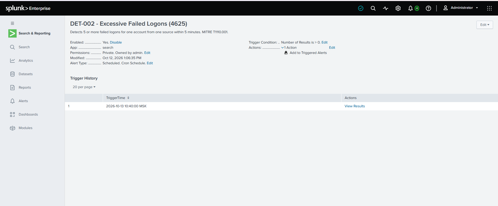
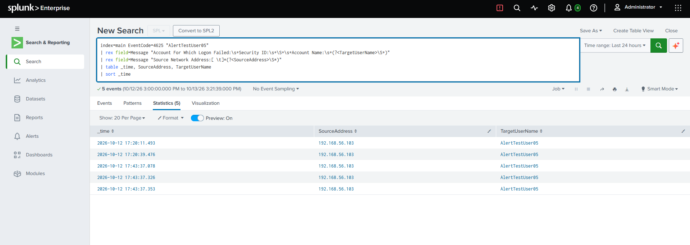
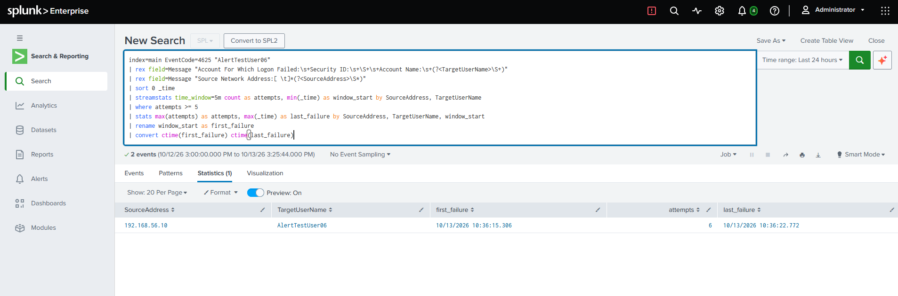

# DET-002: Excessive Failed Logons (Event ID 4625)

| Field | Detail |
|---|---|
| **Status** | Live in lab (runs while the Splunk Enterprise trial licence is valid, until Nov 11, 2026) |
| **Severity** | Medium (stored as `alert.severity = 3`) |
| **Data source** | Windows Security log from `DC01`, forwarded by the Splunk Universal Forwarder |
| **Event ID** | 4625 - An account failed to log on |
| **MITRE ATT&CK** | [T1110.001 - Brute Force: Password Guessing](https://attack.mitre.org/techniques/T1110/001/) |
| **Schedule** | Every 5 minutes (`*/5 * * * *`), 10-minute lookback |
| **Related** | [DET-001](DET-001-new-account-created.md), [07-splunk-siem](../07-splunk-siem/) |

---

## Purpose

Guessing passwords against an account produces a burst of failed logons. This alert fires when one account has 5 or more failed logons from the same source within 5 minutes. A mistyped password produces one or two failures, and an automated tool produces many within seconds.

---

## What a 4625 event contains

```
An account failed to log on.

Subject:
	Account Name:		DC01$
Logon Type:			7

Account For Which Logon Failed:
	Account Name:		Administrator
	Account Domain:		CDMDC

Failure Information:
	Failure Reason:		Unknown user name or bad password.
	Status:			0xC000006D
	Sub Status:		0xC000006A

Network Information:
	Source Network Address:	127.0.0.1
```

Three things in this layout shaped the search:

* **The `Subject` block is the machine, not the person.** It names the system that requested the logon (`DC01$`). The account that failed is in `Account For Which Logon Failed`, so the extraction has to anchor on that heading. Taking the first `Account Name:` would report every failure as `DC01$`.
* **`Sub Status` tells wrong password from wrong username.** `0xC000006A` means the account exists and the password was wrong. `0xC0000064` means the account does not exist.
* **Splunk does not extract these values in this lab.** There is no Windows add-on, so account names and addresses exist only inside the raw `Message` text and are pulled out with `rex`.

---

## Detection logic

```spl
index=main EventCode=4625
| rex field=Message "Account For Which Logon Failed:\s+Security ID:\s+\S+\s+Account Name:\s+(?<TargetUserName>\S+)"
| rex field=Message "Source Network Address:[ \t]*(?<SourceAddress>\S*)"
| sort 0 _time
| streamstats time_window=5m count as attempts, min(_time) as window_start by SourceAddress, TargetUserName
| where attempts >= 5
| stats max(attempts) as attempts, max(_time) as last_failure by SourceAddress, TargetUserName, window_start
| rename window_start as first_failure
| convert ctime(first_failure) ctime(last_failure)
```

* `streamstats time_window=5m` counts failures per account and source over a sliding 5-minute window.
* `where attempts >= 5` keeps only windows that reach the threshold.
* Grouping by `window_start` gives each burst its own row and a start time that matches the first failure.
* `[ \t]*` is used after `Source Network Address:` instead of `\s+`, because `\s+` would run onto the next line when the field is empty.

---

## Alert configuration (as stored)

| Setting | Value |
|---|---|
| Alert type | Scheduled, cron `*/5 * * * *` |
| Time range | Last 10 minutes (`-10m@m` to `now`), overlapping consecutive runs |
| Trigger | Number of results greater than 0, for each result |
| Throttle | Suppress by `SourceAddress,TargetUserName` for 30 minutes |
| Action | Add to Triggered Alerts, severity Medium |
| Permissions | Private, owned by `admin` |

The saved settings were read back from Splunk's REST endpoint:

```spl
| rest /servicesNS/-/-/saved/searches splunk_server=local
| search title="DET-002*"
| table title, search, cron_schedule, dispatch.earliest_time, alert.digest_mode, alert.suppress, alert.suppress.fields, alert.suppress.period, alert.severity
```



---

## Validation

### Positive test (2026-10-13)

`AlertTestUser06`, an existing domain account, was given six wrong passwords from `DC01` against `\\192.168.56.10`. `DC01`'s own Security log recorded six 4625 events between 10:36:15 and 10:36:22. Splunk showed six events: account `AlertTestUser06`, domain `CDMDC`, sub status `0xC000006A`, source `192.168.56.10`. DET-002 fired at 10:40:00 MSK, about 3.5 minutes after the last failure, and the results showed `attempts = 6`.

The source is `DC01` itself, so this is a self-originated test and not a realistic remote attack. The firing in the screenshots below ran the earlier version of the search, which is why its `first_seen` column reads 10:36:22. That is the defect described in the tuning journal, and the stored search above is the corrected one.





### Below-threshold test (2026-10-12)

`AlertTestUser05` was given wrong passwords from `WIN10-CLI01` (`192.168.56.103`) against the DC's IP address. Splunk received five 4625 events, all with sub status `0xC000006A`, in two clusters:

| Time | Events |
|---|---|
| 17:20:11 and 17:20:39 | 2 |
| 17:43:37 (within 0.3 seconds) | 3 |

No 5-minute window held more than three, so the threshold was never reached and the alert could not fire. Whether Splunk was running at that moment was not checked. Five events arrived although two loops of six attempts were run, and the shortfall was not investigated.

This also shows a limit of count-based thresholds: failures spread over 23 minutes pass under a "5 in 5 minutes" rule.



---

## Tuning journal

### 1. Which block holds the account name

The first extraction idea was to take the account name from the top of the event. The raw message shows the top block is the requesting machine (`DC01$`), and the failed account is further down. The pattern anchors on `Account For Which Logon Failed:` instead.

### 2. A start time that was really the threshold-crossing time

**Problem.** In the results of the first firing, `first_seen` was 10:36:22.645 but `DC01`'s Security log showed the first failure at 10:36:15.

**Cause.** `where attempts >= 5` ran before `stats`, so the first four events were discarded and the earliest remaining event was the one that crossed the threshold.

**Fix.** `streamstats` now carries `min(_time)` as `window_start`, and the final `stats` groups by it. A new search against the same events returned `first_failure` 10:36:15.306 and `last_failure` 10:36:22.772, matching the Windows log.



### 3. Two bursts merged into one row

**Problem.** Twelve failures for `AlertTestUser03` came from two loops of six, starting about nine minutes apart (12:12:27 and 12:21:01). The results showed one row spanning 12:12:27 to 12:23:16, which cannot satisfy a 5-minute rule.

**Cause.** The final `stats` grouped only by source and account, so it took the earliest start from one burst and the latest end from the other.

**Fix.** Grouping by `window_start` gives each burst its own row. A 7-day search over the same events then returned two rows for `AlertTestUser03`, each with 6 attempts: 12:12:27 to 12:14:22 and 12:21:01 to 12:23:16.

### 4. Failures that never became 4625 events

**Problem.** Six failed logons against `AlertTestUser06` using the server's hostname (`\\DC01`) produced no 4625 events in Splunk, although the account's creation event arrived and the forwarder was healthy. The same loop against the IP address (`\\192.168.56.10`) produced six.

**Likely cause.** A connection by hostname with a valid domain name may be tried with Kerberos first, and Kerberos failures are logged as 4771, which is not in the forwarder whitelist. An earlier run by hostname with a mistyped domain (`CDMC`) did produce 4625 events, which fits this explanation. The Security log for the hostname run was not checked for 4771, so this is unverified.

**Consequence.** The detection sees NTLM failures logged as 4625 and is blind to anything logged as 4771 or 4776.

---

## Limitations

* **Kerberos and other failure types are not covered.** Events 4771 (Kerberos pre-authentication failed) and 4776 (NTLM credential validation) are not collected.
* **Password spraying is not detected.** The count is per account, so one password tried across many accounts stays under the threshold. That needs a search counting distinct accounts per source.
* **Slow guessing evades it.** See the below-threshold test.
* **The threshold of 5 is untuned.** No baseline of normal failed logons has been measured.
* **The throttle hides repeat bursts.** A second burst by the same account and source within 30 minutes does not alert again.
* **Only `DC01` is monitored.** Failed logons on other machines are not collected.
* **Late events can be missed.** The 10-minute lookback does not reach events indexed after an outage.
* **Licence dependency.** Splunk Free does not include alerting, and the instance warns when an alert is saved that the scheduled search will not run after the trial licence expires (Nov 11, 2026 on this instance). The SPL itself is portable to any licensed Splunk deployment.

---

## Production response

If this fired in a production environment:

1. **Check the sub status.** `0xC000006A` (wrong password) against an existing account is guessing. `0xC0000064` (no such user) is guessing of usernames.
2. **Look for a success afterwards.** A 4624 for the same account and source after the failures would suggest the guess worked, and the severity would rise.
3. **Check the source.** An unknown internal host or an external address, and whether it is expected to authenticate at all.
4. **Reset or lock the account** if a success followed the failures, and review what it accessed.
5. **Collect the missing events.** Add 4771 and 4776 to the forwarder whitelist, and 4740 (account lockout), so the picture is complete.

A worked example of triaging an alert is in [Investigation 01](../investigations/01-unauthorized-account-creation/).
