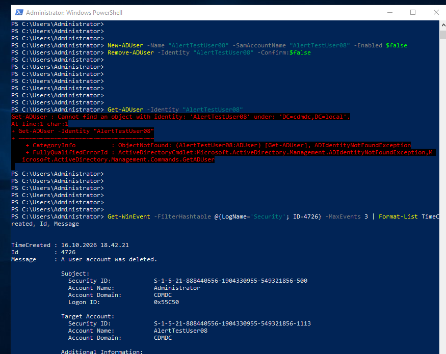
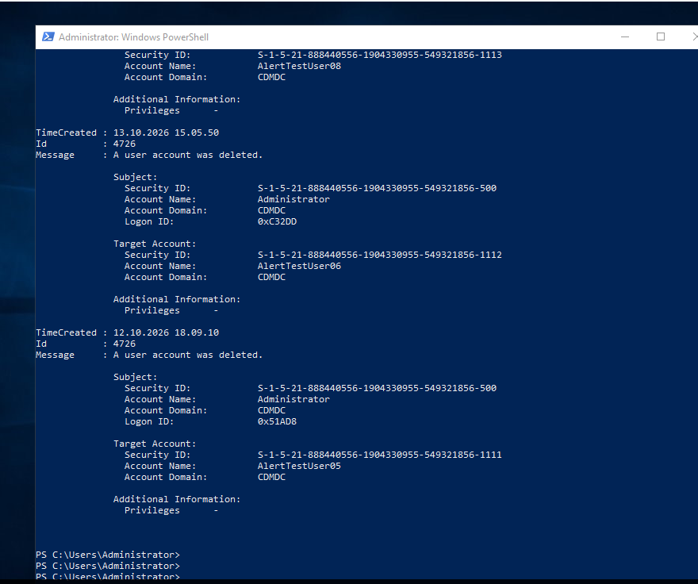
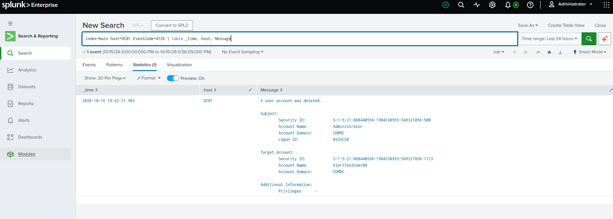
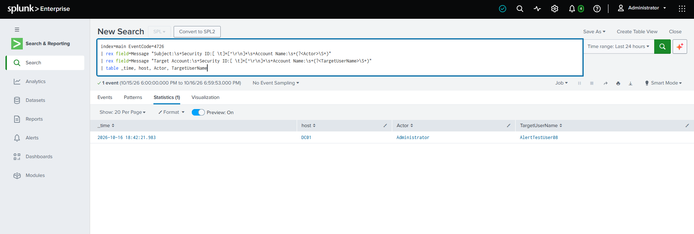
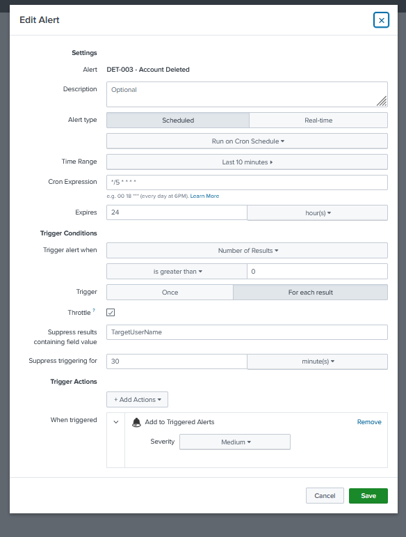
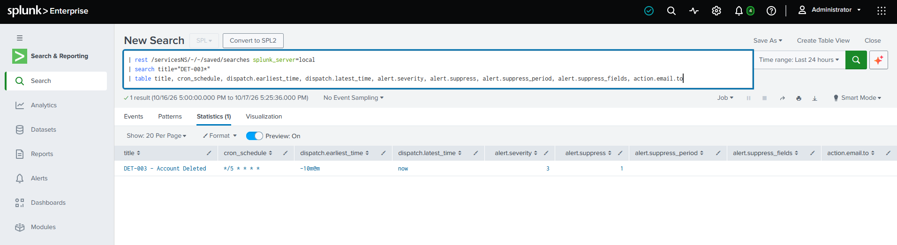
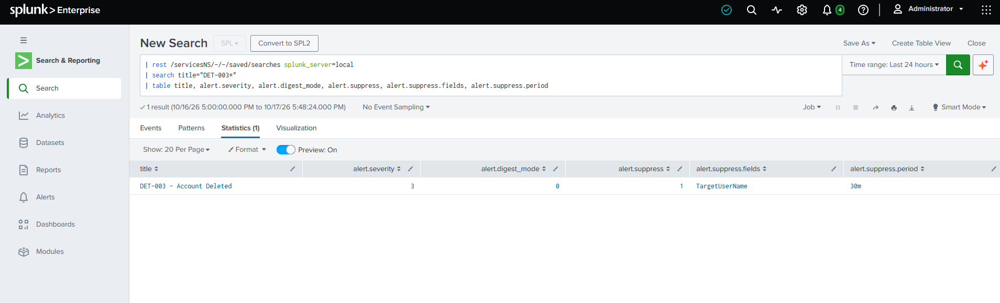
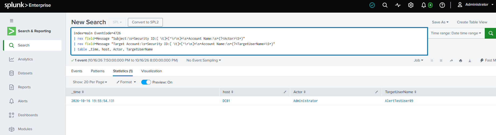
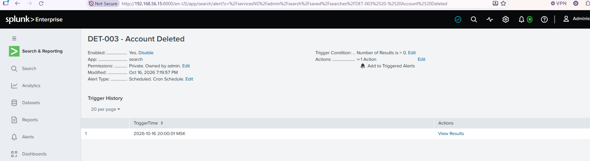
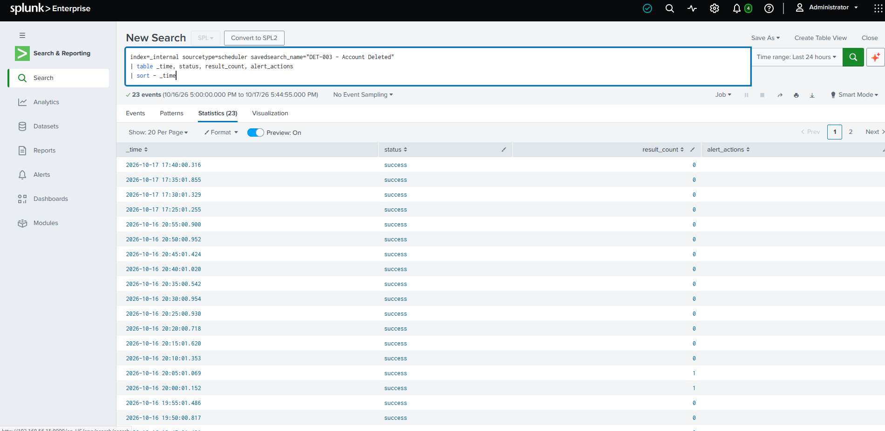

# DET-003: Account Deleted (Event ID 4726)

| Field | Detail |
|---|---|
| Status | Live in lab (runs while the Splunk Enterprise trial licence is valid, until Nov 11, 2026) |
| Severity | Medium (stored as `alert.severity = 3`) |
| Data source | Windows Security log from DC01, forwarded by the Splunk Universal Forwarder |
| Event ID | 4726 - A user account was deleted |
| MITRE ATT&CK | T1531 - Account Access Removal |
| Schedule | Every 5 minutes (`*/5 * * * *`), 10-minute lookback |
| Related | DET-001, DET-002, 07-splunk-siem |

## Purpose

Deleting a domain account is routine during offboarding, but it is also a way to cut a legitimate user off from their access, or to remove an account an intruder created earlier. This alert fires whenever a domain user account is deleted and reports who performed the deletion and which account was removed. DET-001 records when an account appears and DET-003 records when it disappears, so the two together cover an account's lifetime.

## What a 4726 event contains

```
A user account was deleted.

Subject:
	Security ID:		S-1-5-21-888440556-1904330955-549321856-500
	Account Name:		Administrator
	Account Domain:		CDMDC
	Logon ID:		0x55C50

Target Account:
	Security ID:		S-1-5-21-888440556-1904330955-549321856-1113
	Account Name:		AlertTestUser08
	Account Domain:		CDMDC

Additional Information:
	Privileges	-
```

Event as received in Splunk for the test deletion of AlertTestUser08 (2026-10-16).

Things in this layout that shape the search:

- **Two `Account Name:` lines again.** The Subject block is who performed the deletion. The deleted account is under **Target Account**. The extraction anchors on each heading, as in DET-002.
- **The Security ID line holds a value.** Here it is a raw SID, but it can also be a name with a space (for example `NT AUTHORITY\SYSTEM`). A pattern that expects `Security ID:` to be followed straight by `Account Name:` finds nothing, so the patterns below skip the whole line.
- **Splunk does not extract these values in this lab.** There is no Windows add-on, so both names are pulled from the raw `Message` text with `rex`.
- **Computer accounts are a different event.** Deleting a computer account logs 4743, not 4726.

## Prerequisite: Event 4726 is already collected

A search of every `inputs.conf` under the forwarder's `etc` folder found one `[WinEventLog://Security]` stanza (`apps\search\local\inputs.conf`) with no whitelist or blacklist, so the forwarder sends all Security events. No change was needed, and the 4726 from the first test arrived in Splunk. Detection still depends on Audit User Account Management (Success) being enabled on the DC, which DET-001 already relies on.

## Detection logic

```spl
index=main EventCode=4726
| rex field=Message "Subject:\s+Security ID:[ \t]*[^\r\n]*\s+Account Name:\s+(?<Actor>\S+)"
| rex field=Message "Target Account:\s+Security ID:[ \t]*[^\r\n]*\s+Account Name:\s+(?<TargetUserName>\S+)"
| table _time, host, Actor, TargetUserName
```

- Each `rex` anchors on its block heading, so `Actor` is the account that performed the deletion and `TargetUserName` is the account that was removed.
- `[ \t]*[^\r\n]*` skips the Security ID line without running into the next line.

### Companion search for triage: created, then deleted

Not part of the alert. Run it when DET-003 fires, to see whether the deleted account was recently created (DET-001).

```spl
index=main (EventCode=4720 OR EventCode=4726)
| rex field=Message "Subject:\s+Security ID:[ \t]*[^\r\n]*\s+Account Name:\s+(?<Actor>\S+)"
| rex field=Message "(?:New|Target) Account:\s+Security ID:[ \t]*[^\r\n]*\s+Account Name:\s+(?<TargetUserName>\S+)"
| eval created=if(EventCode=4720,_time,null()), deleted=if(EventCode=4726,_time,null())
| stats min(created) as created, max(deleted) as deleted, values(Actor) as Actors by TargetUserName
| where isnotnull(created) AND isnotnull(deleted) AND deleted>created
| eval lifetime_min=round((deleted-created)/60,1)
| convert ctime(created) ctime(deleted)
| sort lifetime_min
```

A short lifetime for an account nobody expected is the pattern worth escalating. A long lifetime is usually normal offboarding.

## Alert configuration (as stored)

| Setting | Value |
|---|---|
| Saved search title | `DET-003 - Account Deleted` |
| Alert type | Scheduled, cron `*/5 * * * *` |
| Time range | Last 10 minutes (`-10m@m` to now), overlapping consecutive runs |
| Trigger | Number of results greater than 0, for each result |
| Throttle | Suppress by `TargetUserName` for 30 minutes |
| Action | Add to Triggered Alerts, severity Medium |
| Permissions | Private, owned by admin |

The overlapping window means the same deletion is seen by two consecutive runs. The throttle on `TargetUserName` is what stops it alerting twice.

## Validation

### Ingestion test (2026-10-16)

AlertTestUser08 was created and deleted on DC01. One 4726 reached Splunk (display time 18:42:21.983), with Subject `Administrator` and Target Account `AlertTestUser08`, both in domain CDMDC. This test ran before the alert existed, so it shows ingestion and extraction only. Extraction was confirmed in the firing test below. The Windows log time for this first test was not compared.









### Alert firing test (2026-10-16)

Run after the alert was saved, with a new account name (AlertTestUser09).

Run on DC01 in an elevated PowerShell session:

```powershell
New-ADUser -Name "AlertTestUser09" -SamAccountName "AlertTestUser09" -Enabled $false
Remove-ADUser -Identity "AlertTestUser09" -Confirm:$false
Get-ADUser -Identity "AlertTestUser09"      # expect: cannot find an object
Get-WinEvent -FilterHashtable @{LogName='Security'; Id=4726} -MaxEvents 3
```

Results:

- DC01 Security log: `Get-WinEvent` shows TimeCreated 16.10.2026 19:55:54 (whole seconds) for the AlertTestUser09 deletion, matching Splunk.
- Splunk: one event for AlertTestUser09 at 19:55:54.131, host DC01, `Actor` = Administrator, `TargetUserName` = AlertTestUser09. The time matches the Windows log to the second.
- Alert: saved as `DET-003 - Account Deleted` (modified 7:19:57 PM, enabled, scheduled cron, trigger Number of Results > 0, action Add to Triggered Alerts). Trigger history shows one firing at 20:00:01 MSK, about 4 minutes after the event, within the 5-minute schedule. REST readback: title `DET-003 - Account Deleted`, cron `*/5 * * * *`, `-10m@m` to now, `alert.severity` = 3, `alert.digest_mode` = 0 (per result), `alert.suppress` = 1, `alert.suppress.fields` = TargetUserName, `alert.suppress.period` = 30m
- Note that the actor is the lab Administrator on DC01 itself, so this is a self-originated test.

Evidence:











### Negative test

The scheduler log for the saved search (`index=_internal sourcetype=scheduler`) shows:

| Run (2026-10-16) | result_count | Meaning |
|---|---|---|
| 19:55:01 | 0 | Ran before the deletion at 19:55:54 |
| 20:00:01 | 1 | First run to see the event; alert fired (trigger history row at 20:00:01 MSK) |
| 20:05:01 | 1 | Lookback (19:55 to 20:05) still contains the event; no second trigger history row |
| 20:10:01 to 20:55:00 | 0 | Event has left the lookback; no deletions occurred |



- **Overlap and throttle.** The 20:05 run found the same event again but did not raise a second alert: trigger history still has one row. This matches the 30-minute throttle on `TargetUserName`.
- **Negative test.** With no deletions, ten consecutive runs from 20:10 to 20:55 returned 0 results and produced no triggers.

## Tuning journal

No extraction or timing problems were found: the extraction matched the real event first time and the Splunk time matched the Windows log. One note on reading the scheduler log:

**`alert_actions` cannot show suppression.** The expectation was that `alert_actions` would be blank on the suppressed 20:05 run and populated on the firing run. It is blank on both. The Add to Triggered Alerts action does not appear in that column, so it cannot tell a fired run from a suppressed one. The evidence for suppression is `result_count` = 1 at 20:05 together with a trigger history that still has a single row.

## Limitations

- **Depends on collection and audit policy.** The alert needs the forwarder to keep sending Security events and Audit User Account Management to stay enabled.
- **Runs only while Splunk is up.** The scheduler log has no runs between 20:55 on 2026-10-16 and 17:25 on 2026-10-17, when the instance was not running. A deletion in that gap would only alert if its event arrived inside a later run's 10-minute window.
- **Domain accounts on DC01 only.** Local account deletions on other machines are not collected.
- **Computer account deletions (4743) are not covered.**
- **No context on the deleted account.** 4726 gives the name and SID, but not group memberships or the account's recent activity. That has to be looked up from earlier events, and the AD Recycle Bin is not covered in this lab.
- **The Actor can be a machine or service account**, which needs interpreting during triage.
- **No baseline.** Normal deletion volume in this lab is near zero, so every deletion alerts. A real environment would need an allowlist for offboarding and automation.
- **The throttle hides repeats.** A second deletion of an account with the same name inside 30 minutes does not alert again.
- **Late events can be missed.** The 10-minute lookback does not reach events indexed after an outage.
- **Log clearing hides it.** Clearing the Security log (1102) removes the evidence, and that is not detected yet.
- **Licence dependency.** The alert runs only while the Splunk Enterprise trial is valid (until Nov 11, 2026). The SPL itself is portable.

## Production response

If this fired in a production environment:

1. **Identify the Actor.** An expected administrator or provisioning account, or something unusual?
2. **Identify the Target.** A standard user, a service account or a privileged account? Privileged and service accounts raise the severity.
3. **Look for a change record or offboarding ticket.** No record means treat it as unauthorised.
4. **Run the companion search.** An account created shortly before deletion suggests an intruder cleaning up.
5. **Pivot on the Actor.** Check 4624 logons, group membership changes and other account management events around the same time.
6. **Check for a Security log clear (1102)** on the same host.
7. **Restore if needed.** Recover the account from the AD Recycle Bin, if enabled, or recreate it and reset access.
