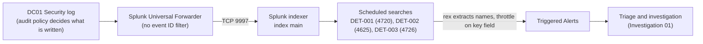

# Cyber-Defense-Lab-Portfolio

I'm building a hands-on Security Operations Center (SOC) home lab from scratch and documenting my progress as I learn defensive security across network monitoring, endpoint security, identity & access management, SIEM engineering, threat hunting, and cloud defense.

**Created by:** Maamar-Sec **Status:** 🚧 In Progress **Started:** April 2026

---

## 📊 Current Progress

| Folder | Topic | Status |
| --- | --- | --- |
| `00-lab-foundation/` | Lab Foundation & Infrastructure Setup | ✅ Completed |
| `01-monitoring-infrastructure/` | Network Traffic Monitoring (TShark, Zeek, Suricata) | ✅ Completed |
| `02-threat-detection/` | Network Monitoring & Threat Detection | ✅ Completed |
| `03-network-protection-layer/` | Network Protection Layer (pfSense + Suricata IPS + pfBlockerNG) | ✅ Completed |
| `04-endpoint-hardening/` | Windows 10 Endpoint Hardening | ✅ Completed |
| `05-linux-server-hardening/` | Linux Server Hardening (UFW, Fail2Ban, auditd) | ✅ Completed |
| `06-active-directory-lab/` | Active Directory Domain Deployment & Administration | ✅ Completed |
| `07-splunk-siem/` | Splunk SIEM Deployment: Universal Forwarder on the Domain Controller, SPL detection searches | ✅ Completed |
| `08-detection-engineering/` | Scheduled Splunk alerts and documented detections (DET-001 to DET-003) | ✅ Completed |
| `investigations/` | Worked investigations of alerts from the detections | 🔄 In Progress |
| Upcoming | Threat Intel, Threat Hunting, IR, Forensics, Cloud Security, Purple Team | 🔜 Planned |

---

## 🔎 Highlights

- **Detection engineering:** three documented Splunk detections (new account created, excessive failed logons, account deleted), each with its logic, stored alert settings, test evidence, tuning journal and known limitations. See [`08-detection-engineering/`](08-detection-engineering/).
- **Worked investigation:** triage of a simulated unauthorized account creation on the Domain Controller. See [Investigation 01](investigations/01-unauthorized-account-creation/).
- **SIEM deployment:** Splunk Enterprise build, forwarder pipeline and the problems solved along the way. See [`07-splunk-siem/`](07-splunk-siem/).

---

## 🔁 Detection Pipeline

The forwarder sends the whole Security log, so the Domain Controller's audit policy, not the forwarder, decides which events exist (as of 2026-10-17, failures are not audited for Kerberos authentication or credential validation). The build is in [`07-splunk-siem/`](07-splunk-siem/) and the detections are in [`08-detection-engineering/`](08-detection-engineering/).

---

## 🏗️ Lab Architecture

**Infrastructure Components**

- Defense Platform: Ubuntu Server 22.04
- Monitored Endpoints: Windows 10, Ubuntu Desktop
- Identity Infrastructure: Windows Server 2019 Active Directory Domain Controller
- SIEM: Splunk Enterprise on Ubuntu Server 22.04, fed by a Universal Forwarder on the Domain Controller
- Virtualization: VirtualBox
- Network Segmentation: NAT + Host-Only + Internal networks
- Firewall & IPS: pfSense + Suricata Inline IPS
- Threat Filtering: pfBlockerNG GeoIP + Reputation Lists

---

## 🎯 Skills Progress

### ✅ Completed

- Virtual lab infrastructure setup
- Basic network configuration and segmentation
- Suricata installation, configuration, IDS/IPS testing
- Network threat detection fundamentals
- pfSense firewall rule design
- pfBlockerNG Geo-blocking & IP reputation filtering
- Full VM routing through pfSense
- Windows 10 endpoint hardening
- Linux server hardening (UFW, Fail2Ban, auditd, SSH hardening)
- Active Directory Domain Services deployment & forest promotion
- Domain-joining Windows endpoints and provisioning domain user accounts
- Kerberos/NTLM authentication verification via PowerShell and CLI tools
- Splunk Enterprise deployment and Universal Forwarder configuration on a Domain Controller
- SPL detections for Windows Security events 4720, 4625 and 4726, built as scheduled alerts (DET-001 to DET-003)
- Detection documentation: logic, stored alert configuration, test evidence, tuning journal and limitations
- First worked investigation: unauthorized account creation (Investigation 01)
- Checking documented configuration against the effective one (btool, auditpol) and correcting the docs

### 🔄 Currently Learning

- Splunk dashboards and further detections (a Kerberos 4768 detection is planned)
- Windows audit policy, including failure auditing for Kerberos and credential validation
- Forwarding WIN10-CLI01 and pfSense/Suricata logs into Splunk
- IDS/IPS tuning
- Network access control

### ⏳ Upcoming

- Threat intelligence integration
- Threat hunting methodology
- Incident response workflows
- Forensics and log analysis
- Cloud security fundamentals
- Purple team testing inside the lab
- A read-only, AI-assisted alert triage prototype on top of the lab

---

## 📂 Portfolio Structure

**Active**

- `00-lab-foundation/` — Core VM and network foundation for the lab
- `01-monitoring-infrastructure/` — Network traffic monitoring with TShark, Zeek, Suricata
- `02-threat-detection/` — Threat detection rules and analysis
- `03-network-protection-layer/` — pfSense, Suricata IPS, pfBlockerNG
- `04-endpoint-hardening/` — Windows 10 endpoint hardening
- `05-linux-server-hardening/` — Linux server hardening (UFW, Fail2Ban, auditd)
- `06-active-directory-lab/` — Active Directory domain deployment, client integration, and authentication validation
- `07-splunk-siem/` — Splunk Enterprise deployment, Universal Forwarder on the Domain Controller, and SPL detection searches
- `08-detection-engineering/` — Scheduled Splunk alerts with documented detections (DET-001 to DET-003)
- `investigations/` — Worked investigations of alerts from these detections

**Planned**

- `09-threat-intelligence/`
- `10-threat-hunting/`
- `11-incident-response/`
- `12-forensics/`
- `13-edr-configurations/`
- `14-vulnerability-management/`
- `15-cloud-security/`
- `16-purple-team/`

---

## 🛠️ Technologies & Tools

**Currently Using**

- VirtualBox, Ubuntu Server 22.04, Windows 10, Windows Server 2019
- Wireshark, Zeek, Suricata, Nmap
- pfSense firewall, pfBlockerNG GeoIP filtering
- Active Directory Domain Services, DNS, Group Policy fundamentals
- Splunk Enterprise, Splunk Universal Forwarder, SPL
- Windows Security event logging, PowerShell

**Planned**

- Volatility, KAPE, OSQuery, MISP
- AWS logging & monitoring
- Atomic Red Team

---

## 📈 Goals

By the end of this project, I aim to have:

- A complete SOC-style home lab
- 20–30 custom detection rules (3 documented so far)
- A working SIEM with dashboards
- Hardened Windows & Linux endpoints
- A functioning Active Directory environment for identity-based detection scenarios
- Basic incident response playbooks
- Documented investigations and lab reports

---

## 📺 Learning Sources

This portfolio is based on:

- The Cyber Defense Mastery series by TechSky
- Additional blogs, documentation, and labs I explore independently

---

## ⚖️ Legal & Ethics

All security activities are carried out strictly within controlled lab environments on systems that I own. This project is dedicated solely to ethical and defensive cybersecurity practices.
